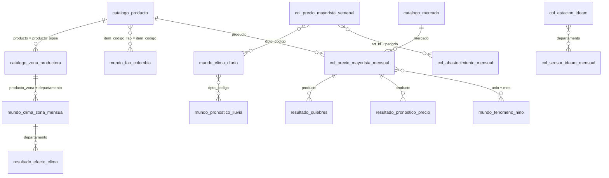

# Diccionario de datos

Qué hay en `data/processed/caso8.duckdb`, tabla por tabla y columna por columna.
La base la construye `scripts/integrar.py` a partir de `src/integration/modelo.py`.

## Cómo leer el nombre de una tabla

El prefijo dice **de dónde viene el dato**:

| Prefijo | Significa | Fuentes |
|---|---|---|
| `col_` | Medido **en Colombia** por una entidad colombiana | SIPSA (DANE), IDEAM |
| `mundo_` | Publicado por una **fuente internacional**, aunque hable de Colombia | FAO, NASA, NOAA, Banco Mundial, Open-Meteo |
| `resultado_` | **Calculado por este proyecto** | `src/indicators/` |
| `catalogo_` | Lista de referencia para cruzar las demás | configuración del proyecto |

El resto del nombre dice qué mide y cada cuánto: `col_precio_mayorista_mensual`.

**La llave de tiempo es `periodo`**: año × 100 + mes. Marzo de 2025 es `202503`.
Todas las tablas mensuales la tienen, y por ella se cruzan.

## Cómo se conectan

El camino central del proyecto es:
**precio** (`col_precio_mayorista_mensual`) → **dónde se cultiva** (`catalogo_zona_productora`)
→ **cuánto llovió allí** (`mundo_clima_zona_mensual`) → **había El Niño** (`mundo_fenomeno_nino`).

## Las 18 tablas de un vistazo

| Tabla | Qué contiene | Una fila es | Filas |
|---|---|---|---|
| `catalogo_producto` | Los productos de SIPSA y su equivalente en la FAO | un producto | 33 |
| `catalogo_mercado` | Las centrales mayoristas y su departamento | un mercado | 20 |
| `catalogo_zona_productora` | Dónde se cultiva cada producto | un producto en un departamento | 13 |
| `col_precio_mayorista_mensual` | Precio mayorista promedio del mes. **La tabla central** | producto + mercado + mes | 34.454 |
| `col_precio_mayorista_semanal` | Precio mayorista por semana y por variedad | artículo + mercado + semana | 230.310 |
| `col_abastecimiento_mensual` | Toneladas que entran a cada central | artículo + mercado + mes | 164.274 |
| `col_sensor_ideam_mensual` | Lluvia y temperatura medidas por sensores | variable + departamento + mes | 1.191 |
| `col_estacion_ideam` | Las estaciones del IDEAM que aportan lecturas | un sensor de una estación | 761 |
| `mundo_fao_colombia` | Los cinco dominios de FAOSTAT para Colombia | dominio + ítem + medida + año | 158.571 |
| `mundo_clima_zona_mensual` | Lluvia y temperatura en las zonas productoras (NASA POWER) | zona + mes | 3.861 |
| `mundo_clima_diario` | Clima diario observado y pronosticado (Open-Meteo) | departamento + día | 19.920 |
| `mundo_pronostico_lluvia` | Lluvia esperada en los próximos meses (Open-Meteo) | departamento + mes | 40 |
| `mundo_fenomeno_nino` | Índice El Niño / La Niña (NOAA) | un mes | 920 |
| `mundo_precio_fertilizantes` | Precio internacional de 5 fertilizantes (Banco Mundial) | fertilizante + mes | 3.921 |
| `resultado_pronostico_precio` | Precio esperado a 1, 2 y 3 meses | producto + mes + horizonte | 3.102 |
| `resultado_efecto_clima` | Cuánto mueve el clima a la oferta y al precio | una relación medida | 140 |
| `resultado_quiebres` | Si un precio cambió de comportamiento al cambiar la fase de El Niño | producto + cambio de fase | 198 |
| `meta_actualizacion` | Bitácora: qué se descargó y cuándo | una descarga | 57 |

---

## Catálogos

### `catalogo_producto`
Los 33 productos con precio mayorista mensual y el ítem de la FAO que les corresponde.
SIPSA y la FAO nombran distinto y agrupan distinto; esta tabla es el único puente entre los dos.

| Columna | Qué es | Ejemplo |
|---|---|---|
| `producto` | Nombre del producto en SIPSA. El asterisco es del DANE | `Papa negra*` |
| `producto_codigo` | Código del producto en SIPSA | `18` |
| `item_codigo_fao` | Código del ítem equivalente en FAOSTAT. Vacío si no hay equivalente | `116` |
| `item_fao` | Nombre de ese ítem en la FAO | `Potatoes` |
| `tipo_correspondencia` | Qué tan buena es la equivalencia: `exacta`, `agregada` (la FAO mezcla varios productos en un código), `generica` (la FAO solo tiene una categoría amplia) o `sin_equivalente` | `agregada` |
| `permite_comparar_precio` | Verdadero solo si es `exacta`: únicamente ahí tiene sentido comparar precio mayorista con precio al productor | `False` |

### `catalogo_mercado`
| Columna | Qué es | Ejemplo |
|---|---|---|
| `mercado` | Nombre de la central mayorista en SIPSA | `MONTERÍA` |
| `productos_con_precio` | Cuántos de los 33 productos tienen precio en ese mercado | `26` |
| `departamento` | Departamento donde está | `Cordoba` |
| `dpto_codigo` | Código DANE del departamento. Con este código se pinta el mapa | `23` |

### `catalogo_zona_productora`
Dónde se cultiva cada producto. Sirve para saber qué lluvia mirar cuando se analiza un precio.

| Columna | Qué es | Ejemplo |
|---|---|---|
| `producto_sipsa` | Producto de SIPSA que se cultiva ahí. Vacío en arroz y café, que tienen clima pero no precio mayorista en la base | `Papa negra*` |
| `producto_zona` | Nombre del cultivo en la tabla de clima | `Papa` |
| `departamento` | Departamento productor | `Boyaca` |
| `lat`, `lon` | Punto donde se consulta el clima (grados decimales) | `5.54`, `-73.36` |

---

## Colombia (`col_`)

### `col_precio_mayorista_mensual` — la tabla central
Fuente: SIPSA (DANE), precios diarios promediados por mes. Cobertura: 2020-02 a 2026-10.
**Sin datos de 2021-01 a 2022-01** (SIPSA no los publica). Ningún precio se imputa: un mes sin dato no tiene fila.

| Columna | Qué es | Ejemplo |
|---|---|---|
| `mercado`, `producto` | Ver los catálogos | `BARRANQUILLA`, `Pepino cohombro` |
| `anio`, `mes`, `periodo` | Mes del precio | `2024`, `11`, `202411` |
| `precio_cop_kg` | Precio promedio del mes, en pesos por kilo | `2421.85` |
| `precio_min`, `precio_max` | El día más barato y el más caro del mes ($/kg) | `1856`, `2729` |
| `dias_con_dato` | Cuántos días del mes tuvieron precio. Pocos días = promedio menos confiable | `13` |
| `item_codigo_fao`, `tipo_correspondencia` | Copia de `catalogo_producto`, para no tener que cruzar | `397`, `exacta` |
| `mes_cerrado` | Falso en el mes en curso, que todavía recibe datos. Las alertas solo usan meses cerrados | `True` |

### `col_precio_mayorista_semanal`
Fuente: SIPSA (DANE). Solo los últimos ~12 meses (el servicio es una ventana móvil): 2025-10 a 2026-10.
Aquí el detalle es el **artículo**: la variedad, calidad y presentación exactas.

| Columna | Qué es | Ejemplo |
|---|---|---|
| `mercado`, `ciudad`, `departamento`, `dpto_codigo` | Dónde se tomó el precio | `Rionegro (Antioquia)`, `Rionegro`, `Antioquia`, `05` |
| `fuen_id` | Código del mercado en SIPSA | `64` |
| `art_id` | Código del artículo en el DANE. **Es la llave**: nunca se promedian artículos distintos | `165` |
| `articulo` | Nombre del artículo | `Papa nevada` |
| `producto` | Producto al que pertenece el artículo | `Papa` |
| `grupo_dane` | Uno de los 8 grupos oficiales del DANE | `Tubérculos, raíces y plátanos` |
| `en_canasta` | Verdadero si el artículo hace parte de la canasta que sigue la app | `True` |
| `semana_inicio` | Primer día de la semana | `2025-11-01` |
| `anio`, `mes`, `periodo` | Mes al que pertenece la semana | `2025`, `11`, `202511` |
| `precio`, `precio_min`, `precio_max` | Precio de la semana, en pesos por `unidad` | `1870`, `1700`, `2000` |
| `unidad` | `kg`, `unidad` (huevo) o `litro` (aceite) | `kg` |

### `col_abastecimiento_mensual`
Fuente: SIPSA (DANE). Cuánta comida entró a cada central: la **oferta**.

| Columna | Qué es | Ejemplo |
|---|---|---|
| `mercado`, `ciudad`, `departamento`, `dpto_codigo`, `fuen_id` | Central que recibió la carga | `Cali, Cavasa`, `Cali`, `Valle del Cauca`, `76`, `47` |
| `art_id`, `articulo`, `producto`, `grupo_dane` | Qué llegó (mismos códigos que el precio semanal) | `443`, `Carne de cerdo`, `Carne de cerdo`, `Carnes` |
| `anio`, `mes`, `periodo` | Mes | `2020`, `7`, `202007` |
| `toneladas` | Toneladas que ingresaron en el mes | `30` |

### `col_sensor_ideam_mensual`
Fuente: sensores automáticos del IDEAM (datos.gov.co), resumidos por departamento y mes.
Es la fuente **de sensor** del proyecto: mide en tierra lo que NASA estima desde satélite.

| Columna | Qué es | Ejemplo |
|---|---|---|
| `variable` | `precipitacion` o `temperatura` | `temperatura` |
| `departamento`, `anio`, `mes`, `periodo` | Dónde y cuándo | `Norte de Santander`, `2023`, `12`, `202312` |
| `valor` | Mediana de las estaciones válidas (mm de lluvia o °C) | `26.10` |
| `anomalia` | `valor` menos lo normal de ese mismo mes en ese departamento. Positivo = más de lo normal | `5.795` |
| `n_estaciones` | Cuántas estaciones aportaron. Con una sola, tomar con cautela | `1` |

### `col_estacion_ideam`
| Columna | Qué es | Ejemplo |
|---|---|---|
| `codigoestacion`, `codigosensor` | Identificadores del IDEAM | `0035035110`, `0068` |
| `nombre`, `departamento`, `municipio` | Dónde está la estación | `SALINAS DE UPIN - AUT`, `Meta`, `RESTREPO` |
| `lat`, `lon` | Ubicación (grados decimales) | `4.27`, `-73.59` |
| `variables` | Qué mide | `['temperatura']` |
| `proporcion_meses_validos` | Parte de los meses con lecturas suficientes (0 a 1) | `0.722` |

---

## Fuentes internacionales (`mundo_`)

### `mundo_fao_colombia`
Fuente: FAOSTAT (FAO), descargas masivas. Todas las filas son de Colombia.
Reúne los cinco dominios que pide el reto; la columna `dominio` dice cuál es cada fila.

| `dominio` | Qué mide | Ítems | Años |
|---|---|---|---|
| `precio_productor` | Precio que recibe el agricultor | 106 | 1991–2025 |
| `produccion` | Área, rendimiento y toneladas producidas | 168 | 1961–2024 |
| `comercio` | Importaciones y exportaciones | 444 | 1961–2024 |
| `balance_alimentario` | De dónde sale y a dónde va cada alimento; disponibilidad por persona | 122 | 2010–2023 |
| `valor_produccion` | Valor económico de la producción | 106 | 1961–2024 |

| Columna | Qué es | Ejemplo |
|---|---|---|
| `dominio` | Ver la tabla de arriba | `precio_productor` |
| `item_codigo`, `item` | Producto según la FAO (nombres en inglés, como los publica) | `399`, `Eggplants (aubergines)` |
| `elemento_codigo`, `elemento` | Qué se está midiendo de ese producto | `5539`, `Producer Price Index (2014-2016 = 100)` |
| `unidad` | Unidad de `valor` (`t`, `ha`, `USD`…). Vacía en los índices | `t` |
| `anio` | Año | `1997` |
| `mes` | Solo en precios al productor mensuales; vacío = dato anual | |
| `valor` | El número | `26.06` |
| `calidad_dato` | Cómo obtuvo la FAO el número: `oficial` (lo reportó el país), `estimado`, `imputado` (la FAO lo calculó porque faltaba) u `organismo internacional` | `estimado` |
| `producto_en_sipsa` | Verdadero si el ítem equivale a un producto con precio mayorista en la base. Los balances usan códigos agregados propios ("Potatoes and products") y hoy no enlazan | `False` |

### `mundo_clima_zona_mensual`
Fuente: NASA POWER (estimación satelital). Cobertura: 1991-01 a 2026-09.

| Columna | Qué es | Ejemplo |
|---|---|---|
| `producto`, `departamento` | La zona productora (ver `catalogo_zona_productora`, columna `producto_zona`) | `Cebolla`, `Boyaca` |
| `anio`, `mes`, `periodo` | Mes | `2015`, `7`, `201507` |
| `precipitacion_mm_dia` | Lluvia promedio del mes, en milímetros por día | `5.95` |
| `temperatura_c` | Temperatura media a 2 m del suelo (°C) | `12.33` |
| `precipitacion_anomalia` | Lluvia del mes menos lo normal de ese mismo mes en esa zona (mm/día). Negativo = llovió menos de lo normal | `0.859` |
| `fuente` | `mensual` (serie oficial de NASA) o `diario` (meses recientes que NASA aún no cierra, armados con su serie diaria) | `mensual` |
| `dias_con_dato` | Solo cuando `fuente = diario`: con cuántos días se armó el mes | |

### `mundo_clima_diario`
Fuente: Open-Meteo. Cobertura: 2020-01-01 hasta 16 días después de la última descarga.

| Columna | Qué es | Ejemplo |
|---|---|---|
| `departamento`, `dpto_codigo` | Dónde | `Boyaca`, `15` |
| `fecha` | Día | `2021-07-29` |
| `precipitacion_mm` | Lluvia del día (mm) | `1.0` |
| `temp_max`, `temp_min` | Temperatura máxima y mínima del día (°C) | `15.7`, `8.8` |
| `tipo` | `observado` (ya pasó) o `pronostico` (los próximos 16 días) | `observado` |
| `fuente` | Servicio de origen | `open-meteo` |

### `mundo_pronostico_lluvia`
Fuente: Open-Meteo, pronóstico estacional. Son 50 escenarios resumidos en tres números.

| Columna | Qué es | Ejemplo |
|---|---|---|
| `departamento`, `dpto_codigo`, `anio`, `mes`, `periodo` | Dónde y para qué mes | `Huila`, `41`, `2026`, `12`, `202612` |
| `precip_p10` | Escenario seco: solo 1 de cada 10 escenarios da menos lluvia (mm en el mes) | `16.1` |
| `precip_p50` | Escenario central: la mitad da más y la mitad da menos | `30.9` |
| `precip_p90` | Escenario lluvioso: solo 1 de cada 10 da más | `87.9` |
| `anomalia_p50` | Escenario central menos la lluvia normal de ese mes (mm). Negativo = se espera menos lluvia de lo normal | `-186.3` |

### `mundo_fenomeno_nino`
Fuente: NOAA, índice ONI. Cobertura: 1950 a 2026.

| Columna | Qué es | Ejemplo |
|---|---|---|
| `anio`, `mes` | Mes central del trimestre | `1961`, `10` |
| `trimestre` | Los tres meses que promedia el índice, por sus iniciales en inglés | `SON` |
| `anomalia` | Cuánto más caliente (+) o fría (−) está el agua del Pacífico frente a lo normal (°C) | `-0.22` |
| `fase` | `El Nino`, `La Nina` o `Neutral` | `Neutral` |
| `provisional` | Verdadero en los últimos meses, que NOAA todavía puede corregir | `False` |

### `mundo_precio_fertilizantes`
Fuente: Banco Mundial, *Pink Sheet*. El archivo trae 71 materias primas; la base conserva
solo los 5 fertilizantes, que son el insumo de los cultivos.

| Columna | Qué es | Ejemplo |
|---|---|---|
| `insumo` | `Urea`, `DAP`, `TSP`, `Potassium chloride **` o `Phosphate rock` | `TSP` |
| `unidad` | Unidad del precio | `($/mt)` (dólares por tonelada) |
| `anio`, `mes`, `periodo` | Mes | `1968`, `11`, `196811` |
| `valor_usd` | Precio internacional en dólares | `36.0` |

---

## Resultados del proyecto (`resultado_`)

### `resultado_pronostico_precio`
Calculado en `src/indicators/pronostico.py`. Precio nacional (mediana de los mercados) por producto.

| Columna | Qué es | Ejemplo |
|---|---|---|
| `producto` | Producto de SIPSA | `Naranja*` |
| `mercado` | Siempre `nacional` | `nacional` |
| `periodo` | Mes del valor | `202603` |
| `tipo` | `real` (precio observado), `prueba` (lo que el modelo habría dicho en el pasado) o `pronostico` (meses futuros) | `real` |
| `horizonte` | A cuántos meses de distancia se pronostica (1, 2 o 3). Vacío en `real` | |
| `valor` | Precio en $/kg | `2301.31` |
| `lim_inf`, `lim_sup` | Banda del pronóstico: el precio debería caer entre estos dos valores | |
| `modelo` | `regresion` (usa clima y El Niño), `estacional` (repite el patrón del año) o `sin_cambio` (supone que sigue igual) | |
| `mae_modelo` | Error promedio del modelo en la prueba contra el pasado (%) | `7.68` |
| `mae_ingenuo` | Error promedio de suponer "el mes que viene será igual" (%) | `5.36` |
| `gana_al_ingenuo` | Verdadero si el modelo se equivoca menos que el supuesto ingenuo. **Si es falso, el pronóstico no aporta** y la app debe decirlo | `False` |

### `resultado_efecto_clima`
Calculado en `src/indicators/sensibilidad.py`. Cada fila es una relación medida en la cadena
El Niño → lluvia → oferta → precio. **Son pistas, no causas probadas.**

| Columna | Qué es | Ejemplo |
|---|---|---|
| `eslabon` | Qué par se relaciona: `oni->lluvia`, `lluvia->oferta`, `oferta->precio`, `lluvia->precio` | `oni->lluvia` |
| `producto`, `art_id`, `departamento` | A qué producto y zona aplica (vacío si el eslabón no es por producto) | `Quindio` |
| `variable` | La variable que explica | `oni` |
| `rezago_meses` | Cuántos meses después se nota el efecto | `5` |
| `coeficiente` | Fuerza y sentido de la relación. Negativo = cuando una sube, la otra baja | `-0.088` |
| `p_valor` | Probabilidad de ver una relación así por puro azar (0 a 1). Bajo = difícil que sea azar | `0.066` |
| `q_valor` | El `p_valor` corregido por haber hecho muchas pruebas a la vez. Es el que se usa para decidir | `0.128` |
| `n` | Con cuántos meses se midió | `429` |
| `metodo` | Cómo se midió (`correlacion_pearson`, regresión…) | `correlacion_pearson` |

### `resultado_quiebres`
Calculado en `src/indicators/quiebres.py` con la prueba de Chow: ¿el precio se comportó
distinto antes y después de que empezara una fase de El Niño o La Niña?

| Columna | Qué es | Ejemplo |
|---|---|---|
| `producto`, `mercado` | Serie analizada (`mercado` es siempre `nacional`) | `Habichuela`, `nacional` |
| `periodo_quiebre` | Mes en que empieza la fase | `202405` |
| `fase_que_empieza` | `El Nino`, `La Nina` o `Neutral` | `Neutral` |
| `que_cambia` | Qué se compara: el `nivel` del precio o su `volatilidad` | `volatilidad` |
| `valor_antes_pct`, `valor_despues_pct` | La medida antes y después del quiebre (%) | `20.2`, `17.0` |
| `n_antes`, `n_despues` | Meses a cada lado | `36`, `29` |
| `f_chow`, `p_valor`, `q_valor` | Estadístico de la prueba y su probabilidad de azar (ver `resultado_efecto_clima`) | `0.685`, `0.408`, `0.977` |
| `hay_quiebre` | Verdadero si el cambio se sostiene tras la corrección | `False` |

---

## Bitácora

### `meta_actualizacion`
La escribe `scripts/actualizar.py` cada vez que consulta una fuente. No se reconstruye: es historial.

| Columna | Qué es | Ejemplo |
|---|---|---|
| `fuente` | Fuente consultada | `open_meteo` |
| `ultimo_periodo` | Hasta qué fecha llegan los datos descargados | `2026-10-08` |
| `fecha_descarga` | Cuándo se descargó | `2026-10-09 22:40` |
| `fecha_actualizacion_fuente` | Cuándo actualizó la fuente sus datos | `2026-10-09 22:40` |
| `estado` | `ok` o el tipo de error | `ok` |
| `filas` | Filas descargadas | `19784` |
| `mensaje` | Detalle del error, si lo hubo | |

---

## Antes → después (reorganización del 15-nov-2026)

La base tenía 27 tablas con prefijos técnicos (`dim_`, `fact_`, `puente_`). Quedó en 18.

| Antes | Después | Qué cambió |
|---|---|---|
| `dim_producto_sipsa` + `puente_producto` | `catalogo_producto` | Eran las mismas 33 filas dos veces |
| `dim_mercado` | `catalogo_mercado` | La columna `series` ahora es `productos_con_precio` |
| `dim_zona_productora` + `puente_zona_sipsa` | `catalogo_zona_productora` | Se quitó `elevacion_grilla_m`: era la altura de la celda de NASA, no la real, y no entraba en ningún cálculo |
| `dim_tiempo` | *(eliminada)* | `primer_dia` era siempre el día 1; `periodo` ya está en cada tabla |
| `dim_item_fao` | *(eliminada)* | Tenía 497 ítems, la mayoría sin uso; el nombre del ítem ahora va en `mundo_fao_colombia` |
| `fact_precio_mayorista` | `col_precio_mayorista_mensual` | Se quitó `imputado`, que era siempre falso |
| `fact_precio_semanal` | `col_precio_mayorista_semanal` | Solo el nombre |
| `fact_abastecimiento` | `col_abastecimiento_mensual` | Solo el nombre |
| `fact_sensor_ideam` | `col_sensor_ideam_mensual` | Año, mes y período pasan a enteros |
| `dim_estacion_ideam` | `col_estacion_ideam` | Solo el nombre |
| `fact_precio_productor`, `fact_produccion`, `fact_comercio`, `fact_balance`, `fact_valor_produccion` | `mundo_fao_colombia` | Cinco tablas con las mismas columnas en una; `flag` (una letra) pasa a `calidad_dato` (una palabra) |
| `fact_tasa_cambio` | *(eliminada del modelo)* | Ningún cálculo la usaba. El dato limpio sigue en `data/interim/faostat/faostat_pe.parquet` |
| `fact_clima` | `mundo_clima_zona_mensual` | Solo el nombre |
| `fact_clima_diario` | `mundo_clima_diario` | Solo el nombre |
| `fact_pronostico_estacional` | `mundo_pronostico_lluvia` | Solo el nombre |
| `fact_enso` | `mundo_fenomeno_nino` | Solo el nombre |
| `fact_insumos` | `mundo_precio_fertilizantes` | De 71 materias primas a los 5 fertilizantes; `commodity` ahora es `insumo` |
| `indicador_sensibilidad_clima` | `resultado_efecto_clima` | Solo el nombre |
| `indicador_quiebres` | `resultado_quiebres` | Solo el nombre |
| `pronostico_precio` | `resultado_pronostico_precio` | Solo el nombre |
| `meta_actualizacion` | `meta_actualizacion` | Sin cambios |

Los resultados calculados no cambiaron: `resultado_pronostico_precio`, `resultado_efecto_clima`
y `resultado_quiebres` tienen exactamente las mismas filas y valores que antes de renombrar.

## Pendiente

- **Enlazar los balances alimentarios con los productos.** Los balances usan códigos agregados
  propios de la FAO ("Potatoes and products", código 2531) distintos de los del resto. Falta una
  tabla de equivalencias revisada por el equipo, igual a `config/homologacion_productos.csv`.
- **Un solo catálogo que llegue hasta el artículo.** El precio mensual (33 productos) y el semanal
  (351 artículos) usan nombres distintos para lo mismo. Hoy los une `mapa_articulos()` en
  `src/indicators/sensibilidad.py`; falta llevar esa equivalencia a `catalogo_producto`.
