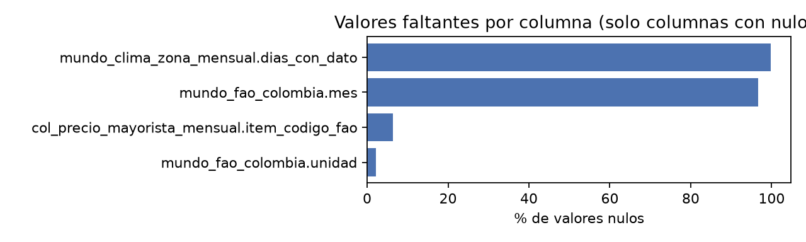
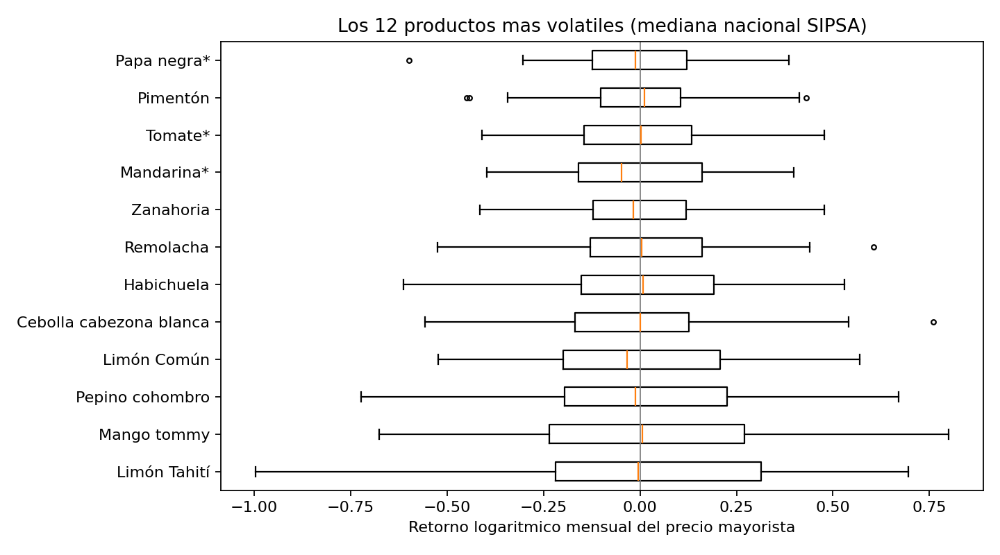
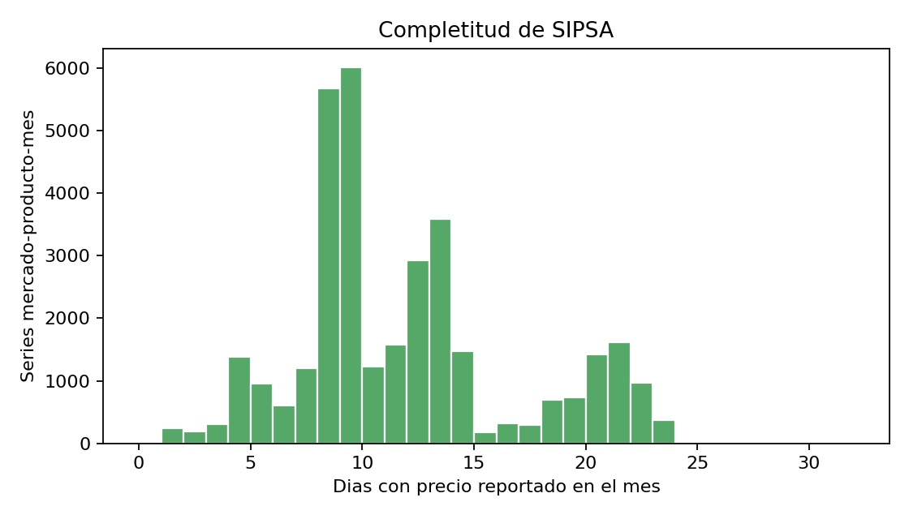
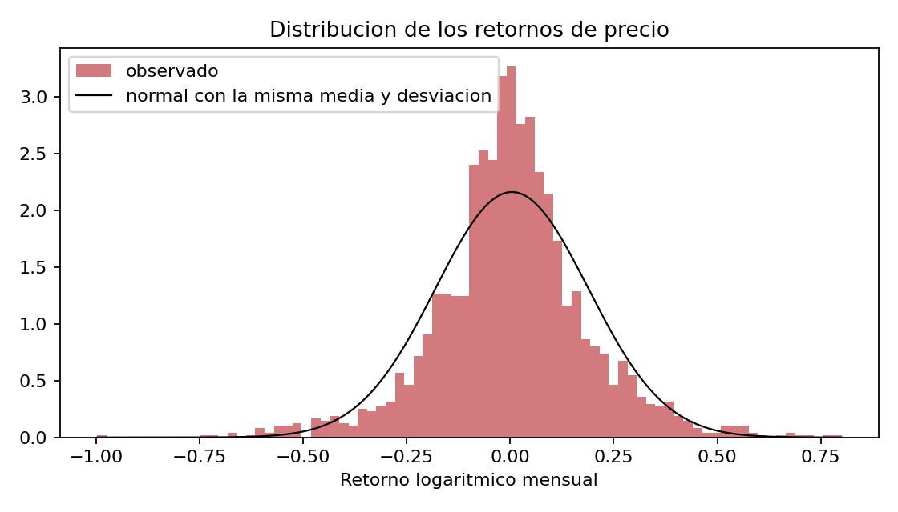
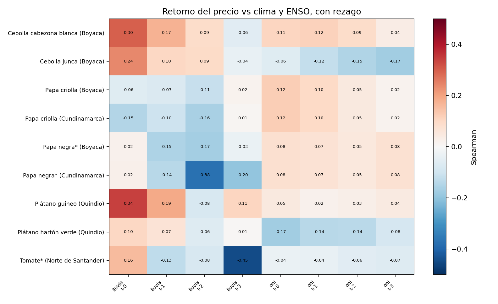

# Exploracion de datos

Generado por `scripts/exploracion.py` sobre `caso8.duckdb`. Solo cifras; la lectura la hace el equipo.

## 1. Estructura

| tabla                        |   filas |   columnas |   numericas |   texto |
|:-----------------------------|--------:|-----------:|------------:|--------:|
| catalogo_mercado             |      20 |          4 |           1 |       3 |
| catalogo_producto            |      33 |          6 |           2 |       3 |
| catalogo_zona_productora     |      13 |          5 |           2 |       3 |
| col_abastecimiento_mensual   |  164274 |         13 |           6 |       7 |
| col_estacion_ideam           |     761 |          9 |           3 |       5 |
| col_precio_mayorista_mensual |   34454 |         12 |           8 |       3 |
| col_precio_mayorista_semanal |  230310 |         18 |           8 |       8 |
| col_sensor_ideam_mensual     |    1191 |          8 |           6 |       2 |
| mundo_clima_diario           |   19920 |          8 |           3 |       4 |
| mundo_clima_zona_mensual     |    3861 |         10 |           7 |       3 |
| mundo_fao_colombia           |  158571 |         11 |           5 |       5 |
| mundo_fenomeno_nino          |     920 |          6 |           3 |       2 |
| mundo_precio_fertilizantes   |    3921 |          6 |           4 |       2 |
| mundo_pronostico_lluvia      |      40 |          9 |           7 |       2 |
| resultado_efecto_clima       |     140 |         11 |           6 |       5 |
| resultado_pronostico_precio  |    3102 |         12 |           7 |       4 |
| resultado_quiebres           |     198 |         13 |           8 |       4 |

## 2. Faltantes

| tabla                        | columna         |   pct_nulos |
|:-----------------------------|:----------------|------------:|
| mundo_clima_zona_mensual     | dias_con_dato   |       99.77 |
| mundo_fao_colombia           | mes             |       96.61 |
| col_precio_mayorista_mensual | item_codigo_fao |        6.34 |
| mundo_fao_colombia           | unidad          |        2.24 |

## 3. Atipicos (regla de Tukey sobre retornos mensuales)

| producto                |   n |   desv |   atipicos |
|:------------------------|----:|-------:|-----------:|
| Limón Tahití            |  65 | 0.3718 |          0 |
| Mango tommy             |  65 | 0.3681 |          0 |
| Pepino cohombro         |  65 | 0.3194 |          0 |
| Limón Común             |  65 | 0.2598 |          0 |
| Habichuela              |  65 | 0.2511 |          0 |
| Cebolla cabezona blanca |  65 | 0.2509 |          1 |
| Remolacha               |  65 | 0.237  |          1 |
| Zanahoria               |  65 | 0.1966 |          1 |
| Mandarina*              |  65 | 0.1958 |          0 |
| Tomate*                 |  65 | 0.1934 |          0 |
| Pimentón                |  65 | 0.1867 |          2 |
| Papa negra*             |  65 | 0.1808 |          1 |
| Papa criolla            |  65 | 0.1768 |          1 |
| Maracuyá                |  65 | 0.1641 |          0 |
| Arveja verde en vaina   |  65 | 0.1632 |          1 |
| Aguacate*               |  65 | 0.155  |          2 |
| Granadilla              |  65 | 0.1546 |          0 |
| Cebolla junca           |  65 | 0.1455 |          1 |
| Tomate de árbol         |  65 | 0.1443 |          2 |
| Papaya maradol          |  65 | 0.1428 |          4 |
| Ahuyama                 |  65 | 0.1237 |          0 |
| Naranja*                |  65 | 0.1192 |          4 |
| Mora de Castilla        |  65 | 0.1187 |          0 |
| Chócolo mazorca         |  65 | 0.1176 |          2 |
| Arracacha*              |  65 | 0.1072 |          5 |
| Plátano guineo          |  65 | 0.1065 |          2 |
| Guayaba*                |  65 | 0.1038 |          0 |
| Plátano hartón verde    |  65 | 0.0953 |          1 |
| Piña *                  |  65 | 0.0912 |          0 |
| Lulo                    |  65 | 0.091  |          1 |
| Yuca*                   |  65 | 0.0832 |          4 |
| Coco                    |  65 | 0.0584 |          2 |
| Banano*                 |  65 | 0.0457 |          2 |

## 4. Calidad: completitud de SIPSA

|               |   count |   mean |   std |   min |   25% |   50% |   75% |   max |   pct_meses_menos_10_dias |
|:--------------|--------:|-------:|------:|------:|------:|------:|------:|------:|--------------------------:|
| dias_con_dato |   34454 |   11.3 |   5.1 |     1 |     8 |    10 |    13 |    23 |                      49.5 |

Meses sin ningun dato en el servicio web de SIPSA (todos los productos):

| desde   | hasta   |   meses_faltantes |   meses_esperados |
|:--------|:--------|------------------:|------------------:|
| 2021-01 | 2022-01 |                13 |                81 |

## 5. Distribucion de retornos

|    n |   media |   desv |   asimetria |   curtosis_exceso |   pct_fuera_de_2_desv |
|-----:|--------:|-------:|------------:|------------------:|----------------------:|
| 2145 |  0.0045 | 0.1839 |      -0.062 |             2.119 |                  6.06 |

## 6. Correlaciones (Spearman, rezago 0-3 meses, n >= 24)

Pares con |rho| >= 0,3: **3** de 72.

| producto       | departamento       | variable   |   rezago_meses |   n |   spearman |
|:---------------|:-------------------|:-----------|---------------:|----:|-----------:|
| Tomate*        | Norte de Santander | lluvia     |              3 |  65 |     -0.448 |
| Papa negra*    | Cundinamarca       | lluvia     |              2 |  65 |     -0.368 |
| Plátano guineo | Quindio            | lluvia     |              0 |  65 |      0.331 |
